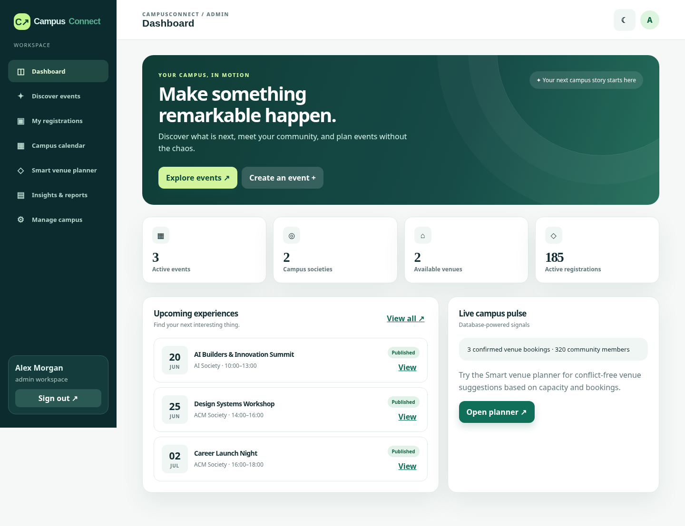
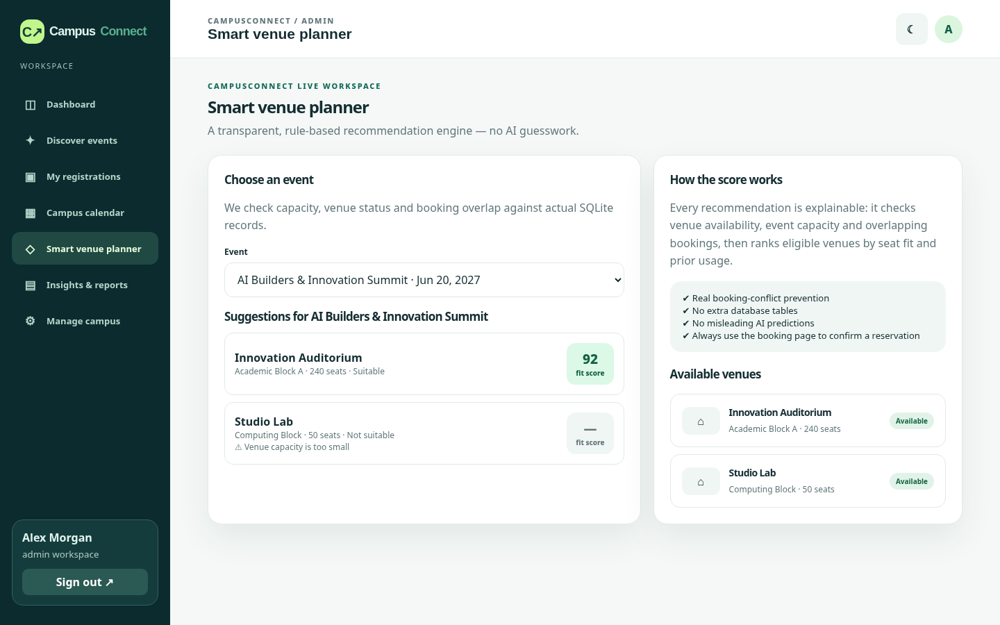
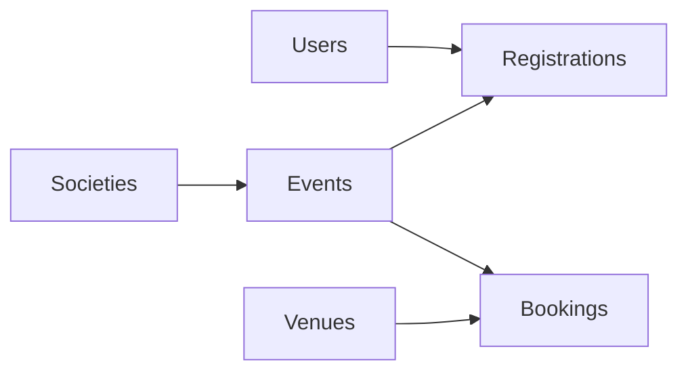

# CampusConnect — Make Campus Happen

A modern university event-management system, designed as a **six-table relational database coursework project**. It includes a responsive student/organizer/admin workspace, a transparent Smart Venue Planner, a live campus calendar, SQL reports, and secure, role-aware workflows.

> **Status:** Portfolio-quality **local development demo**, not a hosted production service. The source is publicly viewable; all real data, database files and credentials remain excluded from the repository.



## Standout features

| Feature | How it works |
| --- | --- |
| Discover & reserve | Search events and see available seat counts based on stored registrations. |
| **Smart Venue Planner** | Explains whether a venue fits an event based on capacity, current venue status, and real booking conflicts. Eligible venues receive a transparent, rule-based fit score. **Not AI prediction.** |
| Campus calendar | Month-by-month schedule directly derived from Events. |
| Role-aware workspace | Student, organizer and admin permissions are enforced by the backend, not just the UI. |
| Live management | CRUD for approved entities; Student accounts are created through sign-up and roles are promoted by administrators. |
| SQL insights | `JOIN`, `COUNT`, `SUM`, `GROUP BY`, live charts and CSV export. |
| Collision prevention | Rejects overlapping venue bookings and duplicate event registration. |
| Responsive experience | Desktop + mobile navigation, optional dark mode, accessible forms, reduced-motion support. |



## Start in under a minute

Install **Node.js 22 or newer**; no `npm install` is required (the app uses Node's built-in `node:sqlite`).

On Windows: double-click **`START.bat`** after extracting the archive.

Or run:

```bash
node server.js
```

Visit **http://127.0.0.1:3000**. The server creates a fresh **local** `campusconnect.db` if none exists. Demo records are fictional. Git does not publish `*.db`, `*.db-wal`, `*.db-shm`, or `.env` files.

### Local demonstration accounts

These are **only for a local development demo** and must never be reused on a public server:

| Role | Email | Password |
| --- | --- | --- |
| Admin | `admin@campusconnect.local` | `Admin@123` |
| Organizer | `organizer@campusconnect.local` | `Organizer@123` |
| Student | `student@campusconnect.local` | `Student@123` |

Student sign-up **cannot self-grant organizer or admin privileges**. An existing admin must promote a user. Production mode requires an explicit administrator bootstrap account and secret; it does not seed demonstration users or events.

## Database — exactly six tables

**Users**, **Societies**, **Events**, **Venues**, **Registrations**, **Bookings**. The original approved database scope is intentionally preserved. No extra operational tables, AI, payments or notification infrastructure were added.



`Registrations` resolves the Users↔Events many-to-many relationship. `Bookings` records assignment of Events to Venues with time and status. Full constraints and indexes: [`DATABASE_SCHEMA.sql`](DATABASE_SCHEMA.sql).

## Project structure

```text
public/
  index.html           Frontend entry
  styles.css           Responsive design + themes
  app.js               Student/admin user flows and API client
server.js              Node HTTP API and relational business logic
DATABASE_SCHEMA.sql    Exactly six SQL tables + indexes
START.bat / START.sh   Local launchers
.github/workflows/     Automatic Node 22 integration tests
tests/                 End-to-end HTTP + SQLite workflow test
docs/                  Architecture, release, and security notes
```

## Tests

```bash
node --check server.js
node --check public/app.js
node --test tests/*.test.cjs
```

**Verified for this release:** the end-to-end integration test passed on Node.js 22, covering authentication, roles, database access, event CRUD, registration and cancellation, conflict rejection, planner recommendations, calendar, CSV reporting and static assets. A separate headless browser preview rendered the responsive interface using **fictional mocked data**, without runtime JS errors. A browser smoke test connected to a live local server was not available in the sandbox, so do not confuse UI previews with production testing.

## Security and public sharing

- **Do not upload your existing SQLite files.** The originally supplied database contains account and event records. This repository starts with fictional local demo records instead.
- Never commit `.env`, private API keys, session cookies, real email addresses of students, or exports.
- Passwords use salted `scrypt`; session signatures use HMAC; signed cookies are HttpOnly and SameSite=Strict.
- This is a course demo, **not audited or penetration-tested**; add HTTPS, monitoring, backups, a rate limiter, CSRF protections appropriate to deployment, stricter onboarding, and load tests before production.
- If demonstrating publicly, use a clean synthetic database and strong unique credentials.

See [`docs/SECURITY.md`](docs/SECURITY.md) for deployment cautions and [`docs/RELEASE_NOTES.md`](docs/RELEASE_NOTES.md) for the changed features.

## License

No license has been selected. Public visibility allows viewing the source but does **not** automatically grant others permission to reuse it. The owner can choose a license later.
